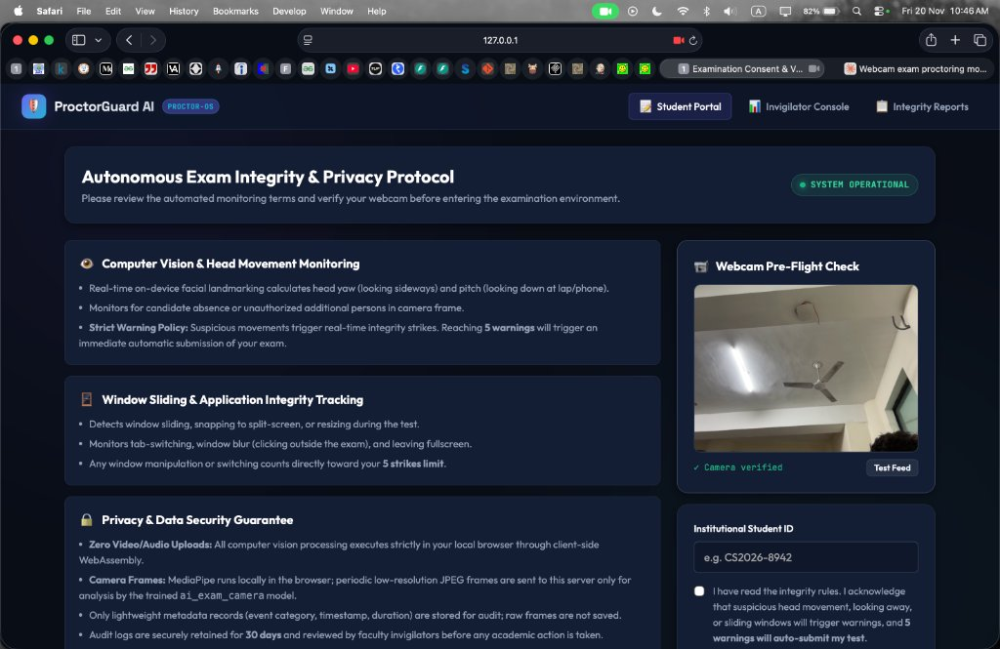
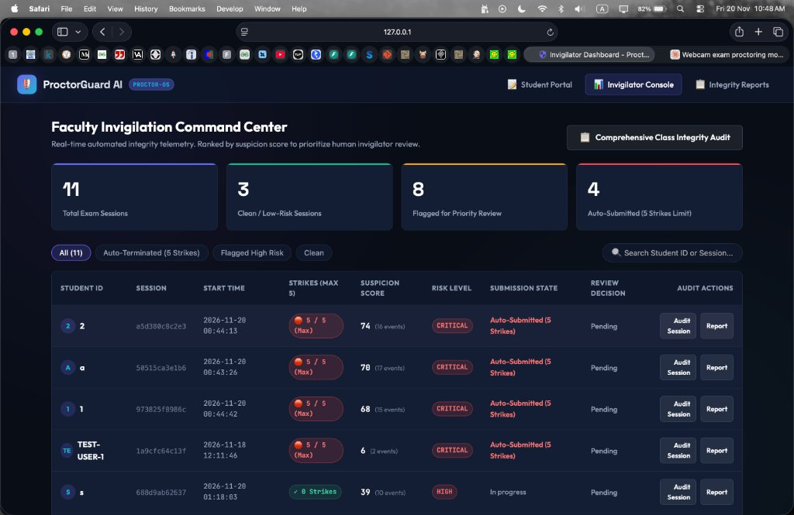
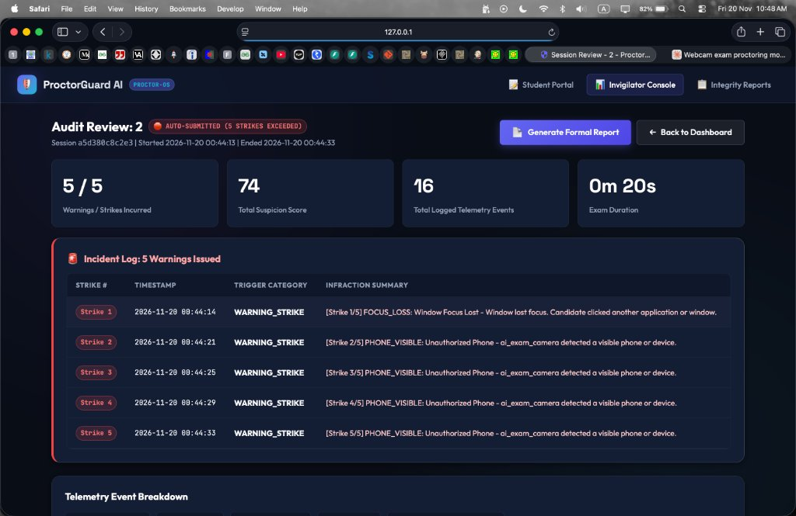
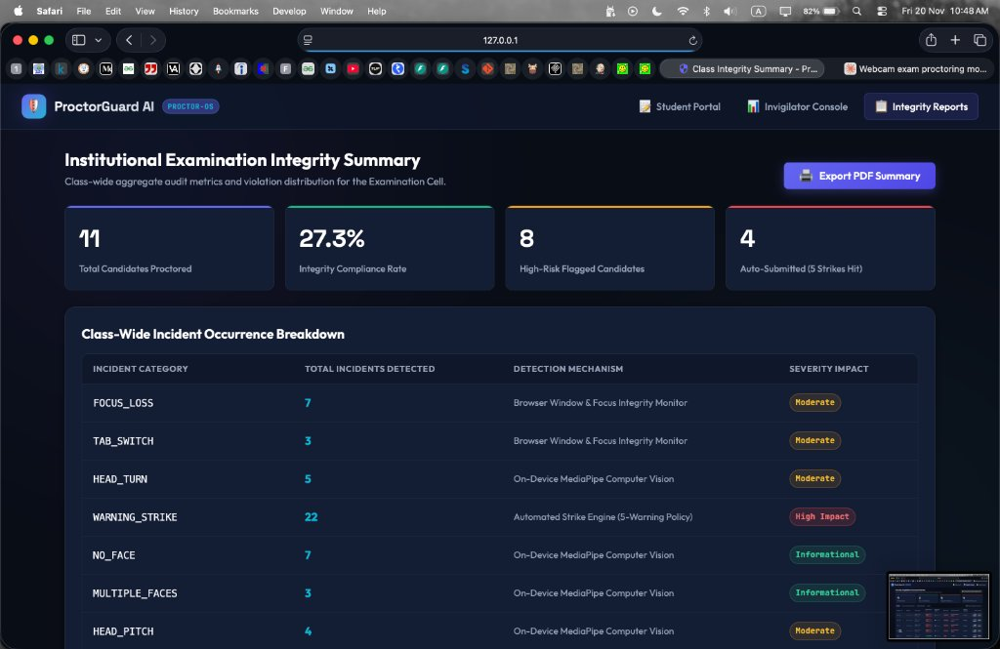

<p align="center">
  
  
  
  
  
</p>

# 🛡️ ProctorGuard AI — Autonomous Exam Integrity Monitoring System

> **AI-powered online examination proctoring** with browser-based computer vision, real-time strike enforcement, automatic test submission, and a comprehensive invigilator command console — all while preserving student privacy with zero video uploads.

---

## 📸 Screenshots

### Student Portal — Exam Consent & Privacy Protocol


### Faculty Invigilator Command Center


### Session Audit Review — Strike Log & Telemetry


### Institutional Examination Integrity Summary


---

## ✨ Key Features

### 🧠 Computer Vision Integrity Engine (Client-Side MediaPipe)
| Capability | Description |
|---|---|
| **Head Movement & Pose Analysis** | Continuous Yaw (turning left/right) and Pitch (looking down at lap/phone, looking up) estimation via facial landmarks |
| **Eye Gaze Tracking** | Iris landmark detection to identify sustained sideways glances |
| **Candidate Absence Detection** | Real-time identification when the candidate leaves the frame |
| **Multi-Face Detection** | Flags unauthorized additional persons in the camera frame |
| **Phone/Device Detection** | AI camera model detects visible phones or unauthorized devices |
| **HUD Canvas Overlay** | Futuristic cyber reticles, face tracking brackets, and live sensor telemetry rendered over the webcam feed |

### 🪟 Window Sliding & Application Integrity Monitoring
- **Window Sliding / Split-Screen Detection** — Monitors viewport dimensions and window bounds (macOS Split View, Windows Snap)
- **Tab-Switching & Minimizing** — Instant detection via `visibilitychange` API
- **Focus Loss** — Detects clicks outside the browser or onto other applications
- **Clipboard & DevTools Protection** — Intercepts copy, paste, cut, right-click, and DevTools shortcuts

### ⚠️ 5-Warning Strike Enforcement & Auto-Submission
1. Each suspicious event triggers an immediate **Warning Strike (1–5)**
2. **Audio-Visual Alerts** — Web Audio API synthesizer generates urgent tones; screen pulses red with a high-impact warning modal
3. **Automatic Test Submission** — At **5 warnings**, the exam is frozen, answers are secured, and the test is **auto-submitted** for invigilator review

### 🔒 Privacy-Preserving Edge Architecture
- All computer vision executes in the browser via **WebAssembly** — zero video or audio leaves the device
- Only lightweight metadata (event type, timestamp, duration) is stored server-side
- Audit logs retained for **30 days** and reviewed by faculty before any action

### 📊 Invigilator Command Console & Reporting
| View | Route | Description |
|---|---|---|
| **Live Dashboard** | `/dashboard` | KPI cards, risk-tier filtering, search, and quick audit actions |
| **Session Deep Dive** | `/session/<sid>` | Itemized strike log, telemetry breakdown, submitted answers, and adjudication panel |
| **Candidate Report** | `/report/<sid>` | Print-ready PDF audit report with risk matrix and sign-off blocks |
| **Class Integrity Summary** | `/report` | Aggregate compliance rates, incident distribution, and examination cell metrics |

---

## 🏗️ System Architecture

```
┌─────────────────────────────────────────────────────────────────┐
│                      STUDENT BROWSER (Client)                   │
│                                                                 │
│  ┌──────────────┐  ┌──────────────┐  ┌────────────────────┐    │
│  │  MediaPipe    │  │  Window &    │  │  5-Strike Warning  │    │
│  │  FaceLandmark │  │  Tab Monitor │  │  Engine + HUD      │    │
│  │  (WASM)       │  │              │  │                    │    │
│  └──────┬───────┘  └──────┬───────┘  └────────┬───────────┘    │
│         │                 │                    │                │
│         └─────────────────┴────────────────────┘                │
│                           │  Events (JSON)                      │
└───────────────────────────┼─────────────────────────────────────┘
                            │  POST /event  (metadata only)
                            ▼
┌─────────────────────────────────────────────────────────────────┐
│                      FLASK SERVER (Backend)                      │
│                                                                 │
│  ┌──────────────┐  ┌──────────────┐  ┌────────────────────┐    │
│  │  Session &    │  │  Suspicion   │  │  AI Exam Camera    │    │
│  │  Event Store  │  │  Scoring     │  │  (PyTorch Model)   │    │
│  │  (SQLite)     │  │  Engine      │  │                    │    │
│  └──────────────┘  └──────────────┘  └────────────────────┘    │
│                                                                 │
│  ┌──────────────┐  ┌──────────────┐  ┌────────────────────┐    │
│  │  Invigilator │  │  Audit       │  │  PDF Report        │    │
│  │  Dashboard   │  │  Session View│  │  Generator          │    │
│  └──────────────┘  └──────────────┘  └────────────────────┘    │
└─────────────────────────────────────────────────────────────────┘
```

---

## 🚀 Quickstart

### Prerequisites
- **Python 3.10+**
- A webcam (for student-side proctoring)
- Google Chrome or Safari (for MediaPipe WebAssembly support)

### 1. Clone & Install

```bash
git clone <repository-url>
cd cse472
pip install -r requirements.txt
```

### 2. Run the Application

```bash
python app.py
```

### 3. Access the System

| Portal | URL |
|---|---|
| 🎓 **Student Exam Portal** | [http://localhost:5000/](http://localhost:5000/) |
| 🏛️ **Invigilator Dashboard** | [http://localhost:5000/dashboard](http://localhost:5000/dashboard) |
| 📄 **Class Integrity Report** | [http://localhost:5000/report](http://localhost:5000/report) |

> **Note:** Webcams require `localhost` or HTTPS. Allow camera access when prompted by the browser.

---

## 📁 Project Structure

```
cse472/
├── app.py                      # Flask server, SQLite DB, session endpoints, report generation
├── proctor.db                  # SQLite database (sessions, events, reviews, answers)
├── requirements.txt            # Dependencies (Flask, OpenCV, PyTorch, etc.)
├── static/
│   ├── proctor.js              # MediaPipe CV, HUD overlay, window tracker, 5-strike engine
│   └── style.css               # Cyber-proctor dark theme, HUD widgets, modals
├── templates/
│   ├── base.html               # Layout with navigation bar and branding
│   ├── consent.html            # Pre-flight camera test & privacy disclosure
│   ├── exam.html               # Live exam interface with HUD camera & strikes bar
│   ├── done.html               # Submission confirmation & strike receipt
│   ├── dashboard.html          # Invigilator dashboard with KPI cards and search
│   ├── session.html            # Candidate session audit and review adjudication
│   ├── report.html             # Formal printable candidate integrity report
│   └── report_class.html       # Class-wide aggregate integrity report
├── evaluation/
│   ├── evaluate.py             # Precision, Recall, F1 evaluation harness
│   └── ground_truth.csv        # Benchmark labels for detection validation
└── screenshots/                # Application screenshots for documentation
```

---

## 🎯 Suspicion Scoring Engine

Each telemetry event is weighted to calculate a **Suspicion Score** that ranks sessions for human review. The score **never auto-penalizes** — it only prioritizes which sessions an invigilator should review first.

| Event Category | Weight | Detection Source |
|---|---|---|
| `PHONE_VISIBLE` | 5 | AI Exam Camera (PyTorch) |
| `MULTIPLE_FACES` | 5 | On-Device MediaPipe CV |
| `AUTO_SUBMIT_VIOLATIONS` | 10 | Strike Enforcement Engine |
| `WARNING_STRIKE` | 4 | Automated Strike Engine |
| `NO_FACE` | 3 | On-Device MediaPipe CV |
| `TAB_SWITCH` | 3 | Browser Window Monitor |
| `WINDOW_SLIDE` | 3 | Browser Window Monitor |
| `HEAD_TURN` / `HEAD_DOWN` / `HEAD_UP` | 2 | On-Device MediaPipe CV |
| `FOCUS_LOSS` / `FULLSCREEN_EXIT` / `WINDOW_RESIZE` | 2 | Browser Window Monitor |
| `GAZE_AWAY` / `CLIPBOARD_ATTEMPT` | 1 | Browser Monitoring |

---

## 🎮 Demo — Simulating Integrity Violations

| Step | Action | Expected Result |
|---|---|---|
| 1 | **Turn your head** left/right for ~2 seconds | HUD reticle turns amber/red → Warning #1 fires with audio beep |
| 2 | **Look down** at your lap/phone for ~2 seconds | Pitch sensor triggers → Warning #2 added to strike bar |
| 3 | **Snap/slide the browser** to the side or click another window | Immediate window activity warning → Strike registered |
| 4 | **Accumulate 5 warnings** | Emergency Lockdown screen → Alarm tone → Inputs frozen → Auto-submitted |

---

## 🔐 Privacy & Data Security

- ✅ **Zero Video/Audio Uploads** — All CV processing runs client-side via WebAssembly
- ✅ **MediaPipe In-Browser** — Camera frames are processed locally; only periodic low-res JPEG frames sent for AI camera analysis
- ✅ **Lightweight Metadata Only** — Event type, timestamp, and duration stored; raw frames are **not** saved
- ✅ **30-Day Retention** — Audit logs securely retained and reviewed by faculty before any academic action
- ✅ **Informed Consent** — Students must review and acknowledge all monitoring terms before entering the exam

---

## 🛠️ Tech Stack

| Layer | Technology |
|---|---|
| **Backend** | Python, Flask 3.0+, SQLite |
| **AI / CV (Client)** | MediaPipe FaceLandmarker (WebAssembly) |
| **AI / CV (Server)** | PyTorch, OpenCV, Pillow |
| **Frontend** | HTML5, CSS3, JavaScript (Web Audio API, Canvas API) |
| **Data** | Pandas, NumPy (evaluation pipeline) |

---

## 📈 Evaluation

Run the evaluation harness to compute Precision, Recall, and F1 scores against the ground truth labels:

```bash
cd evaluation
python evaluate.py
```

---

## 📝 License

This project was developed as part of the **CSE 472** coursework.

---

<p align="center">
  <b>ProctorGuard AI</b> — Autonomous integrity monitoring that respects privacy and empowers fair examinations.
</p>
